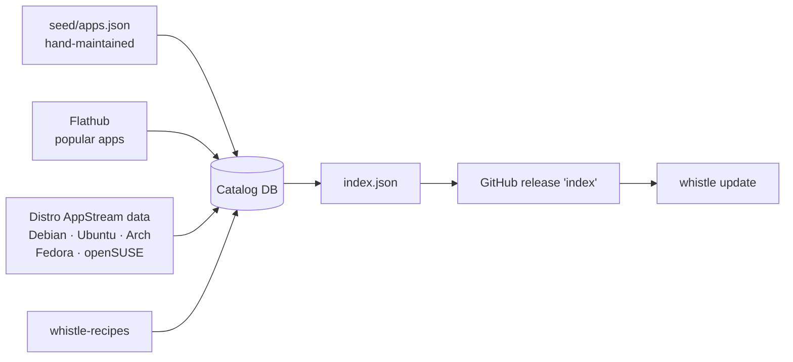

<p align="center">
  
</p>

<h1 align="center">whistle-server</h1>

<p align="center">
  <b>The catalog behind <a href="https://github.com/thisisroot/whistle">Whistle</a>.</b><br>
  Which apps exist, every way to install each one, and the recipes for running apps on the other OS.
</p>

<p align="center">
  <a href="https://github.com/thisisroot/whistle-server/actions/workflows/publish-index.yml"></a>
  <a href="https://github.com/thisisroot/whistle-server/releases/tag/index"></a>
  
  
  <a href="LICENSE"></a>
</p>

<p align="center">
  <a href="#how-the-catalog-is-built">How it's built</a> ·
  <a href="#contributing-to-the-catalog">Contributing</a> ·
  <a href="#run-it-locally">Run it locally</a> ·
  <a href="#commands">Commands</a> ·
  <a href="#settings">Settings</a>
</p>

The server builds one file: **`index.json`**, the catalog the `whistle` client
downloads with `whistle update`. The current one is always at
[`releases/download/index/index.json`](https://github.com/thisisroot/whistle-server/releases/download/index/index.json).

| | |
| --- | --- |
| **Apps** | about 1,000 |
| **With a native package** | about 380 (Debian, Ubuntu, Arch, Fedora, openSUSE) |
| **Flatpak** | almost all, from Flathub |
| **Windows apps** | through [whistle-recipes](https://github.com/thisisroot/whistle-recipes) |
| **Rebuilt** | on every push to `main` and once a day |

## How the catalog is built



The catalog is rebuilt from scratch every time, from four sources:

1. **`seed/apps.json`**: hand-maintained apps and their package names (apt,
   pacman, dnf, zypper, winget). Always wins over imported data.
2. **Flathub**: the most popular apps, with their names, icons, summaries and
   Flatpak refs. It only fills in what's missing.
3. **The distros' own AppStream metadata**: the package that ships each app on
   Debian, Ubuntu, Arch, Fedora and openSUSE. Apps are matched by their
   AppStream ID (like `org.gimp.GIMP`), never by name, so a different program
   that happens to share a name is never picked. If a distro's feed is down, that
   distro keeps its previous data.
4. **[whistle-recipes](https://github.com/thisisroot/whistle-recipes)**: one
   recipe per app, with its review status from `seed/recipe-status.json`.

The [Publish index](.github/workflows/publish-index.yml) workflow runs the
tests, builds the catalog and uploads `index.json` to the
[`index` release](https://github.com/thisisroot/whistle-server/releases/tag/index).

## Contributing to the catalog

| To... | Edit |
| --- | --- |
| Add an app or fix a package name | [`seed/apps.json`](seed/apps.json) |
| Promote a recipe to `community` or `verified` | [`seed/recipe-status.json`](seed/recipe-status.json) |
| Add a recipe for running an app on the other OS | [whistle-recipes](https://github.com/thisisroot/whistle-recipes) |

Recipe statuses:

| Status | Meaning |
| --- | --- |
| `draft` | New and unreviewed. Clients only offer it with `--allow-draft`. |
| `community` | Reviewed and reported working. |
| `verified` | Tested end to end by a maintainer: install, launch, remove. |
| `retired` | Its file was removed from whistle-recipes. No longer offered; kept so old reports still make sense. |

Open a pull request. The catalog is code: edits made in the Django admin of a
local database are not published.

## Run it locally

You need [uv](https://docs.astral.sh/uv/), and a checkout of
[whistle-recipes](https://github.com/thisisroot/whistle-recipes) next to this one.

```sh
uv sync
uv run python manage.py migrate
uv run python manage.py import_index seed/apps.json
uv run python manage.py ingest_flathub --limit 1000
uv run python manage.py ingest_appstream
uv run python manage.py index_recipes ../whistle-recipes --status-file seed/recipe-status.json
uv run python manage.py build_index index.json
```

Point the client at the result with `whistle update --from index.json`.

To browse the data, create an admin user with
`uv run python manage.py createsuperuser`, run `uv run python manage.py runserver`
and open http://localhost:8000/admin/.

Run the tests with `uv run python manage.py test`. Fedora's AppStream data is
zstd-compressed, so `ingest_appstream` needs either the `zstandard` Python
package or the `zstd` command.

## Commands

| Command | What it does |
| --- | --- |
| `import_index <file>` | Import apps and sources from an index-format JSON file. |
| `ingest_flathub [--limit N]` | Import the N most popular Flathub apps (default 500). |
| `ingest_appstream [--only FEED...] [--strict]` | Add native packages from the distros' AppStream data. `--strict` fails if any feed fails. |
| `index_recipes <repo> [--status-file F]` | Index every recipe in a whistle-recipes checkout. |
| `build_index <file>` | Write the index clients download. |

## Settings

| Variable | Default | Effect |
| --- | --- | --- |
| `WHISTLE_DEBUG` | `1` | Set to `0` in production. |
| `WHISTLE_SECRET_KEY` | dev key when debugging | Required when `WHISTLE_DEBUG=0`. |
| `WHISTLE_ALLOWED_HOSTS` | `localhost,127.0.0.1` | Comma-separated. |
| `WHISTLE_SQLITE_PATH` | `db.sqlite3` | SQLite file to use. |
| `POSTGRES_DB` and co. | unset | Use Postgres instead of SQLite. |
| `WHISTLE_RECIPES_DIR` | `../whistle-recipes` | Recipes checkout the tests read. |

## Layout

| Path | Contents |
| --- | --- |
| [`catalog/models.py`](catalog/models.py) | App, Source, Recipe, RecipeRevision, CompatReport. |
| [`catalog/index.py`](catalog/index.py) | Build the index, and import index-format seed files. |
| [`catalog/ingest.py`](catalog/ingest.py) | The Flathub import. |
| [`catalog/appstream.py`](catalog/appstream.py) | The AppStream import: DEP-11, AppStream XML and Fedora's RPM. |
| [`catalog/recipes.py`](catalog/recipes.py) | Validate a recipe and store it as a revision. |
| [`accounts/`](accounts) | Users, for contributors and compatibility reports. Installing apps never needs an account. |
| [`seed/`](seed) | The hand-maintained part of the catalog. |

## License

[AGPL-3.0-or-later](LICENSE). If you run a modified version of this server for others, you must
share its source under the same license. The catalog data it publishes is not covered by this:
recipes are CC0, and imported metadata keeps its original terms.
